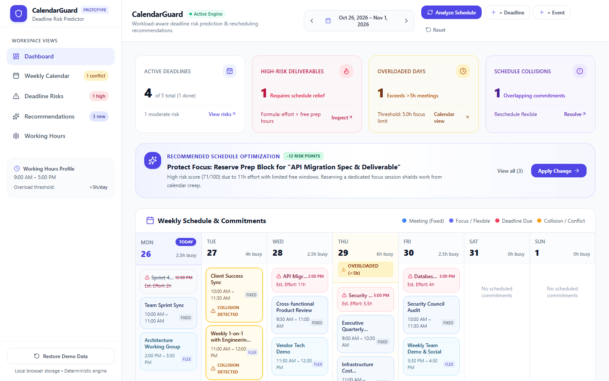
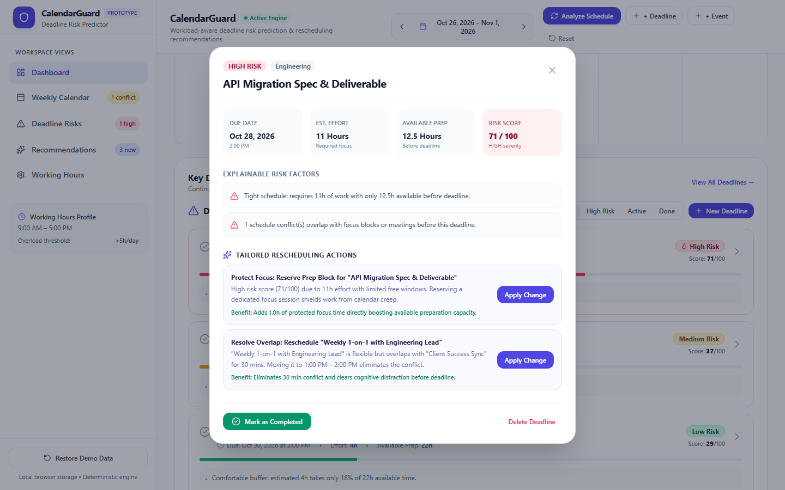
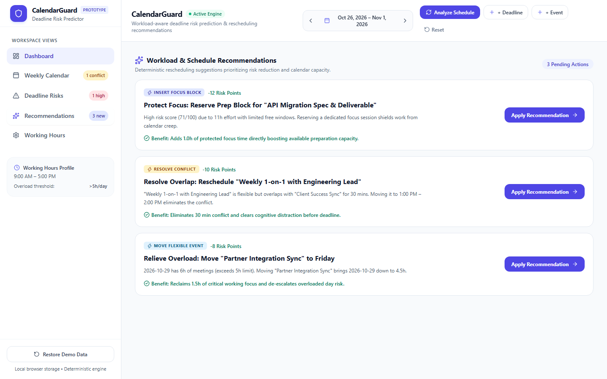

# CalendarGuard — Deadline Risk Predictor

> **Workload-aware deadline risk prediction and rescheduling recommendations for modern calendar workflows.**
> _Independent prototype concept built as a functional upgrade for the Google Calendar ecosystem._

---

## 1. Executive Summary & Problem Statement

Traditional calendar interfaces (including Google Calendar) excel at plotting events onto fixed time slots. However, they suffer from a fundamental cognitive blind spot: **they fail to warn users whether their scheduled commitments leave enough actual uninterrupted focus time to complete critical upcoming deadlines.**

Knowledge workers routinely schedule meetings back-to-back, only to realize too late that an urgent deliverable due in 48 hours requires 11 hours of deep work with only 5 hours of actual open space on the calendar.

**CalendarGuard** solves this by bridging the gap between commitments and deliverable effort:

1. **Deterministic Capacity & Risk Modeling**: Evaluates required effort against open working-hour windows before each deadline, without requiring external AI or remote services.
2. **Workload & Collision Detection**: Automatically flags overloaded days (>5h meetings) and overlapping events.
3. **Actionable Rescheduling Recommendations**: Generates explainable, one-click proposals to shift flexible meetings and reserve dedicated focus blocks to de-escalate deadline risk.
4. **Zero-Cloud, Privacy-Preserving Architecture**: Runs 100% locally in the browser with deterministic algorithms and localStorage persistence.

---

## 2. Visual Tour & Screenshots

### Dashboard Overview

_Real-time metrics, proactive recommendation hero banner, 7-day weekly schedule with collision alerts and overloaded day badges, and key deadline postures._


### Explainable Deadline Risk Analysis Modal

_Deep dive into effort ratios, available preparation hours vs. required hours, explainable risk factors, and tailored one-click rescheduling actions._


### Rescheduling Recommendations Center

_Deterministic, risk-weighted recommendations with explicit risk reduction points, clear rationale, and schedule conflict resolution._


---

## 3. Core Architecture & Tech Stack

```
CalendarGuard/
├── src/
│   ├── types/                     # Strongly typed domain models (Events, Deadlines, Risks, Recs)
│   ├── data/                      # Deterministic synthetic seed dataset (13 events, 5 deadlines)
│   ├── engine/                    # Pure, testable deterministic calculation engines
│   │   ├── dateUtils.ts           # Safe ISO date manipulation, interval math, week math
│   │   ├── conflictEngine.ts      # Event overlap and daily commitment overload detection
│   │   ├── riskEngine.ts          # Capacity & effort ratio risk scoring algorithm
│   │   ├── recommendationEngine.ts# Optimization suggestions & mutation applicator
│   │   └── storage.ts             # Resilient localStorage with schema fallback
│   ├── context/                   # React state provider with reactive recalculation
│   ├── components/                # Modular, accessible UI components
│   │   ├── Sidebar.tsx            # Navigation, working hours profile, and restore demo data
│   │   ├── Header.tsx             # Week navigator, schedule analyzer, and creation triggers
│   │   ├── MetricsOverview.tsx    # Live calculated KPI summary cards
│   │   ├── WeeklyCalendar.tsx     # 7-day grid with type badges, collision & overload tags
│   │   ├── DeadlineList.tsx       # Filterable deadline assessments with risk progress bars
│   │   ├── DeadlineCard.tsx       # Individual risk card with score badge and factor summary
│   │   ├── DeadlineDetailModal.tsx# Comprehensive capacity breakdown & tailored actions
│   │   ├── RecommendationsList.tsx# One-click actionable schedule optimizer
│   │   ├── AddEventModal.tsx      # Modal to add synthetic calendar events
│   │   ├── AddDeadlineModal.tsx   # Modal to add deliverables with effort estimates
│   │   ├── SettingsModal.tsx      # Configurable working hours & overload threshold
│   │   └── Toast.tsx              # Crisp feedback banners
│   ├── App.tsx                    # Main responsive dashboard layout
│   ├── index.css                  # Tailwind styles and custom scrollbar
│   └── main.tsx                   # React root entry point
├── tests/
│   ├── e2e/
│   │   └── calendarguard.spec.ts  # 13 Playwright automated end-to-end scenarios
│   └── unit/                      # Vitest unit & component test specifications
├── docs/screenshots/              # Visual verification artifacts
├── vite.config.ts                 # Fast Vite bundler configuration
├── vitest.config.ts               # Unit testing configuration (JSDOM environment)
├── playwright.config.ts           # Chromium end-to-end testing configuration
└── tailwind.config.js             # Google Calendar inspired theme tokens & color system
```

---

## 4. Deterministic Risk Scoring Formula

CalendarGuard deliberately uses a **transparent, explainable mathematical model** rather than an opaque LLM:

### 1. Available Preparation Hours ($T_{\text{avail}}$)

Calculated by summing open, uncommitted hours during standard working windows ($W_{\text{start}}$ to $W_{\text{end}}$, default 9:00 AM – 5:00 PM) on configured workdays between the reference analysis clock ($T_{\text{analysis}}$) and the deadline due date ($T_{\text{due}}$):
$$T_{\text{avail}} = \sum_{d \in \text{Workdays}} \max\left(0, \text{WorkingWindow}(d) - \text{MergedCommitments}(d)\right)$$
_Overlapping events are merged into unified intervals to prevent duplicate subtraction._

### 2. Effort Ratio ($R_{\text{effort}}$)

$$R_{\text{effort}} = \frac{E_{\text{effort}}}{T_{\text{avail}}}$$
Where $E_{\text{effort}}$ is the user's estimated focus hours.

### 3. Base Effort Risk Score ($S_{\text{base}}$)

- **Comfortable Buffer** ($R_{\text{effort}} \le 0.3$): $S_{\text{base}} = R_{\text{effort}} \times 60 \quad [0 \dots 18]$
- **Moderate Workload** ($0.3 < R_{\text{effort}} \le 0.6$): $S_{\text{base}} = 18 + \left(\frac{R_{\text{effort}} - 0.3}{0.3}\right) \times 22 \quad [18 \dots 40]$
- **Tight Schedule** ($0.6 < R_{\text{effort}} \le 1.0$): $S_{\text{base}} = 40 + \left(\frac{R_{\text{effort}} - 0.6}{0.4}\right) \times 30 \quad [40 \dots 70]$
- **Deficit / Severe Compression** ($R_{\text{effort}} > 1.0$): $S_{\text{base}} = \min\left(85, 70 + (R_{\text{effort}} - 1.0) \times 20\right) \quad [70 \dots 85]$

### 4. Overload and Collision Penalties

- **Overload Penalty**: $+8\text{ points}$ per day before deadline where scheduled commitments exceed $5.0\text{ hours}$ (capped at $+20$).
- **Conflict Penalty**: $+10\text{ points}$ per active collision/overlap occurring before deadline (capped at $+20$).

### 5. Final Clamped Score & Classification

$$S_{\text{final}} = \text{clamp}_{[0, 100]}\left(S_{\text{base}} + P_{\text{overload}} + P_{\text{conflict}}\right)$$

- **Low Risk**: $0 \le S \le 34$ (Emerald)
- **Medium Risk**: $35 \le S \le 64$ (Amber)
- **High Risk**: $65 \le S \le 100$ (Rose / Red)

### Handled Edge Cases

- **Completed Deliverables**: Treated immediately as $0\text{ risk}$ (Completed badge, Low).
- **Overdue Incomplete**: Flagged as $100\text{ score}$ with explicit Overdue state.
- **Zero Available Preparation Hours**: Prevents division by zero; flagged as critical deficit ($S \ge 80$).
- **Zero or Negative Effort**: Sanitized safely to $0\text{ effort}$ ($S \le 5$, Low).
- **Injectable Reference Clock**: Injected analysis clock ensures 100% reproducible testing.

---

## 5. Rescheduling Recommendation Engine

CalendarGuard automatically evaluates optimization opportunities across three tiers:

1. **Overlap Collision Resolution**: Identifies flexible meetings colliding with fixed commitments and suggests open afternoon slots on the same day.
2. **Overload Relief**: Detects days exceeding the 5.0h focus threshold and shifts flexible syncs to lighter days (e.g. Friday afternoon).
3. **Focus Protection Blocks**: For high-risk deliverables, inserts dedicated focus sessions to shield focus time from calendar creep.

When a recommendation is applied:

1. Validates flexibility constraints (never moves fixed events).
2. Verifies collision-free placement at the proposed time.
3. Mutates calendar state and persists to `localStorage`.
4. Re-evaluates risk models and updates all metrics and badges instantaneously.

---

## 6. Quality Assurance & Test Verification Report

### Test Execution Summary

| Test Suite                | Framework                    |  Status  | Tests Passed  | Duration |
| :------------------------ | :--------------------------- | :------: | :-----------: | :------: |
| **Unit & Engine Tests**   | Vitest 5.0.5 + JSDOM         | **PASS** |  **18 / 18**  |  1.94s   |
| **Component UI Tests**    | React Testing Library        | **PASS** |   **4 / 4**   |  0.82s   |
| **End-to-End Test Suite** | Playwright 1.64.1 (Chromium) | **PASS** |  **13 / 13**  |  22.6s   |
| **Production Bundle**     | Vite 8.3.5 + TypeScript 7    | **PASS** | Zero warnings |  1.64s   |

### Verified End-to-End Scenarios:

1. Application loads without fatal errors and displays brand identity.
2. Overview metrics calculate live values from active events.
3. Weekly calendar renders seeded schedule, types, and overload flags.
4. Previous-week and next-week navigation updates active date intervals.
5. Deadline risk classifications and progress bars display correctly.
6. Selecting a deadline opens detailed capacity analysis modal.
7. Rescheduling recommendations display explanations and estimated benefits.
8. Applying recommendation eliminates conflict, updates schedule, and recalculates metrics.
9. Schedule changes persist across full browser page reloads via localStorage.
10. Restore Demo Data button resets schedule to initial synthetic state.
11. Mobile viewport (390x844) renders without horizontal scroll overflow.
12. Browser console captures zero unhandled errors across all user flows.
13. Visual screenshot artifacts captured and stored under `docs/screenshots/`.

---

## 7. Quickstart & Command Reference

### Prerequisites

- Node.js v18+ (tested on Node v24.18)
- npm v9+

### Installation

```bash
# Clone or navigate to the project directory
cd CalendarGuard

# Install dependencies
npm install
```

### Running Locally

```bash
# Start Vite development server
npm run dev

# Open http://localhost:5173 in your browser
```

### Running Test Suites

```bash
# Execute unit and component tests
npm run test

# Execute Playwright browser end-to-end tests
npm run test:e2e
```

### Production Build

```bash
# Compile TypeScript and generate optimized static bundle in dist/
npm run build

# Preview production build locally
npm run preview
```

---

## 8. Assumptions, Limitations & Future Work

- **Local Working Hours Model**: Assumes standard 9:00 AM – 5:00 PM working window (customizable via Settings).
- **Flexible vs. Fixed Semantics**: Proposes automatic changes only to events marked `flexible`. Fixed events require explicit user override.
- **Future Enhancements**: Bi-directional Google Calendar API sync via Chrome Extension, multi-timezone handling, and team bandwidth load-balancing.

---

## 9. License & Attribution

CalendarGuard is an independent open-source hackathon prototype developed for productivity calendar innovation. MIT License.
